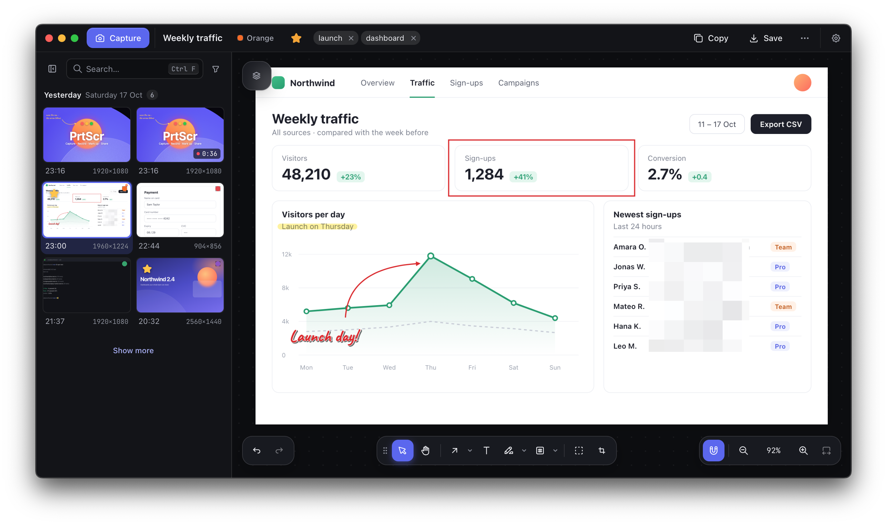
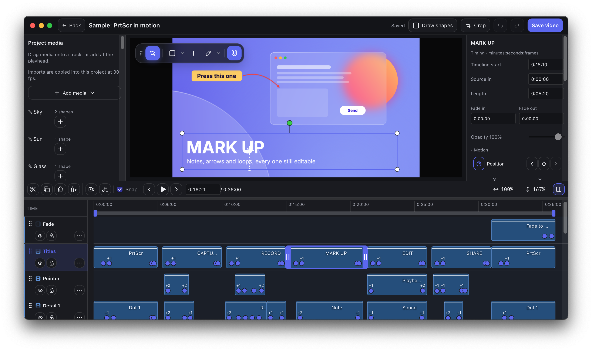
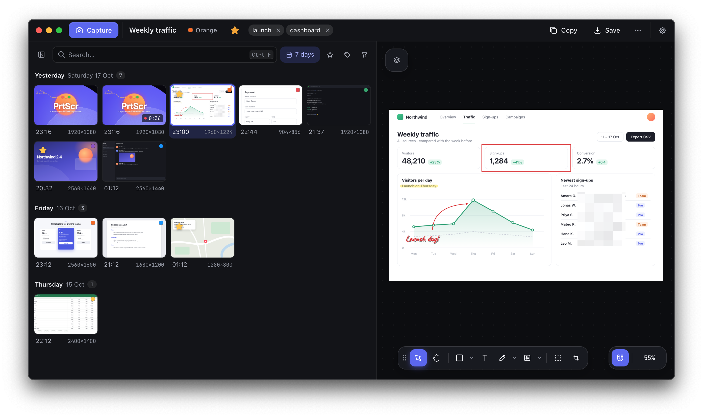
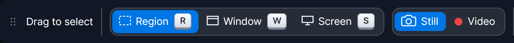

# PrtScr

**Press one key. Capture, mark up, record and share, all on your own machine.**

Screenshots and screen recordings for Windows and macOS, with a real editor built in. 
No account. No watermark. Your captures stay on your disk.

[**Download for Windows**](https://github.com/BieleckiLtd/PrtScr-releases/releases/latest/download/PrtScr-setup.exe)
&nbsp;·&nbsp;
[**Download for Mac**](https://github.com/BieleckiLtd/PrtScr-releases/releases/latest/download/PrtScr-macos.dmg)
&nbsp;·&nbsp;
[Website](https://bieleckiltd.github.io/PrtScr-releases/)
&nbsp;·&nbsp;
[All releases](https://github.com/BieleckiLtd/PrtScr-releases/releases)

<table>
  <tr>
    <td width="50%"></td>
    <td width="50%"></td>
  </tr>
  <tr>
    <td align="center"><b>Record and edit</b> Titles, pointer effects, fades and music on a timeline</td>
    <td align="center"><b>Find it again</b> Every capture, kept on your disk</td>
  </tr>
</table>

Screenshots of PrtScr. The pages, names and figures in the captures are made up.

## What you can do

- **Capture in one key.** A region, a window, the screen under your pointer, or every screen at
  once, across monitors at different scaling. Copy it straight to the clipboard.
- **Mark it up.** Arrows that stay attached to what they point at, boxes, ellipses, a pen and a
  highlighter, and styled text in several fonts. Blur or pixelate anything private. Gradients,
  an eyedropper that reaches anywhere on screen, and undo for everything.
- **Record your screen** to MP4, then trim, crop and cut it on a multi-track timeline with fades,
  crossfades, music and animated titles.
- **Share it.** Copy a picture, or drag a finished recording straight into a chat.
- **Never lose anything.** Crops, trims and edits never touch the original, so you can widen or
  undo them later. Deleted captures wait 30 days before they go.
- **Keep it yours.** The library lives on your disk. Back it up or sync it between computers
  only if you want to: a folder, a network share, SFTP, WebDAV, FTP, S3-compatible storage,
  OneDrive, Google Drive or Dropbox.

## Install on Windows

1. Download **[PrtScr-setup.exe](https://github.com/BieleckiLtd/PrtScr-releases/releases/latest/download/PrtScr-setup.exe)**
   and run it.
2. Windows SmartScreen may say the publisher is unknown, because the installer is not signed
   yet. Choose **More info**, then **Run anyway**.
3. Setup installs PrtScr for you alone, with no administrator prompt. Screen recording and a
   few sample captures are selected; untick either if you don't want it. Recording downloads
   PrtScr's own checked copy of FFmpeg, and Setup fetches Microsoft's WebView2 only if your
   computer doesn't have it.
4. PrtScr waits in the system tray. Press <kbd>PrtScr</kbd> to capture and
   <kbd>Ctrl</kbd>+<kbd>Alt</kbd>+<kbd>PrtScr</kbd> to record. If another app already has the
   key, PrtScr takes the next free shortcut and tells you which one.

Needs 64-bit Windows 10 version 2004 or later, or Windows 11. If you left recording out, add it
any time from **Settings → Optional features**.

## Install on macOS

1. Download **[PrtScr-macos.dmg](https://github.com/BieleckiLtd/PrtScr-releases/releases/latest/download/PrtScr-macos.dmg)**,
   open it and double-click **Install PrtScr**.
2. PrtScr is not notarized by Apple yet, so the first time macOS says it cannot verify Install
   PrtScr. Click **Done**, open **System Settings → Privacy & Security**, click **Open Anyway**
   beside Install PrtScr and confirm.
3. Install PrtScr downloads the version for your Mac, Apple silicon or Intel, puts it in
   Applications and opens it. PrtScr itself then opens without asking.
4. PrtScr lives in the menu bar. Press <kbd>Shift</kbd>+<kbd>Cmd</kbd>+<kbd>2</kbd> to capture
   and <kbd>Ctrl</kbd>+<kbd>Shift</kbd>+<kbd>R</kbd> to record; a PC keyboard's Print Screen
   works too, and Settings changes either.
5. The first time you capture, macOS asks for permission to record the screen. Turn PrtScr on in
   **System Settings → Privacy & Security → Screen Recording**, then quit and reopen it.

Needs macOS 13 or later. Would you rather drag the app to Applications yourself? Each release
also has the app's own disk images: `PrtScr-macos-arm64.dmg` for Apple silicon and
`PrtScr-macos-x64.dmg` for Intel.

## Updates

PrtScr keeps itself up to date on both systems. It downloads a new version in the background and
switches to it when you choose **Restart to update**, when you are away from the computer, or
the next time PrtScr starts. Settings can turn that off, and **Check for updates** is in Settings
and in the tray or menu bar menu.

## Privacy

Nothing you capture leaves your computer unless you send it or connect a backup location.
There is no account. Error reports are off unless you turn on **Send anonymous error reports**;
a report says what failed and where in PrtScr, with your names, folders and e-mail addresses
taken out, and Settings lists each one exactly as it was sent.

## What each release holds

| File | What it is |
| --- | --- |
| `PrtScr-setup.exe` | The Windows installer, always the newest (also as `PrtScr-<version>-win-x64-setup.exe`). |
| `PrtScr-macos.dmg` | Install PrtScr for macOS, which installs the right version for your Mac. |
| `PrtScr-macos-arm64.dmg`, `PrtScr-macos-x64.dmg` | The Mac app itself, for Apple silicon and for Intel. |
| `prtscr-update.json` | What installed copies read to find an update: the version, where each download is, its size and its SHA-256. A copy installs an update only if the download matches. |

## Problems

[Open an issue](https://github.com/BieleckiLtd/PrtScr-releases/issues) saying what you did and
what happened. PrtScr's log helps:

- Windows: `%LOCALAPPDATA%\PrtScr\logs\app.log`
- macOS: `~/Library/Application Support/PrtScr/logs/app.log`

This repository holds PrtScr's releases and its website. Its source is kept elsewhere.
